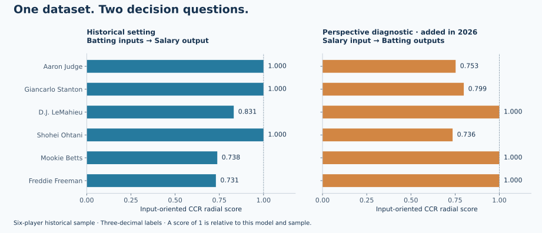

# MLB Performance and Pay: From DEA Scores to Value Judgments

**Data Envelopment Analysis · Linear Programming · Case Analysis · Data Storytelling**

[繁體中文](README.md) · [Case study](docs/case-study.zh-TW.md) · [Methodology](docs/methodology.md) · [Reproduction](docs/reproduce.md)

**Does better batting performance necessarily lead to higher pay—and whose question does an efficiency score answer?**

This case examines six MLB players using 12 batting measures labeled as 2023 performance and salary figures labeled as 2024 pay in a historical team presentation. It connects relative efficiency to the wider question of sporting performance, commercial value and contract risk. A 2026 reconstruction adds executable linear programs, source reconciliation and perspective comparisons.



## What the model actually measures

The original presentation treats **batting measures as inputs and salary as output**. Its radial input-efficiency score therefore evaluates the stated performance-to-pay configuration. It does not establish value for money from a club's perspective.

| Player | Reported score | Reconstructed CCR | BCC extension | Club-perspective extension |
|---|---:|---:|---:|---:|
| Aaron Judge | 1.000 | 1.000000 | 1.000000 | 0.752840 |
| Giancarlo Stanton | 1.000 | 1.000000 | 1.000000 | 0.798989 |
| D.J. LeMahieu | 0.831 | 0.831409 | 1.000000 | 1.000000 |
| Shohei Ohtani | 1.000 | 1.000000 | 1.000000 | 0.735824 |
| Mookie Betts | 0.738 | 0.738323 | 0.787132 | 1.000000 |
| Freddie Freeman | 0.731 | 0.730530 | 0.816253 | 1.000000 |

The club-perspective extension reverses the roles: salary becomes the input and batting measures become outputs. This is an illustrative diagnostic with the same historical data limitations, not a validated player valuation. The change in results makes the analytical question visible.

## A source discrepancy with a measurable consequence

Betts's salary appears as **US$30M** in the summary but **US$30,416,667** in the projection table. The latter reproduces the reported score of 0.738; the former yields 0.728209. Both source versions are retained. All six reported scores and six peer weights match within their three-decimal rounding; 39 projection rows are checked. [Data dictionary](data/README.md) · [Evidence review](docs/evidence-review.md)

## Analytical work

- Reconcile slide-level records, salary versions, peer weights and radial/slack projections.
- Solve explicit input-oriented CCR and BCC linear programs with SciPy/HiGHS.
- Compare model assumptions and evaluate numerical feasibility and unit invariance.
- Explain the Stanton–Freeman contrast through a sequence of question, evidence, interpretation and decision implications.
- Separate on-field contribution, commercial value and contract uncertainty in a proposed decision framework.

## Reproduce

Validated with Python 3.14 and the pinned dependencies in `requirements.txt`.

```bash
python3 -m venv .venv
source .venv/bin/activate
python -m pip install -r requirements.txt
python scripts/reproduce.py --check
python -m unittest discover -s tests -v
python scripts/build_figures.py --check
python scripts/verify_publication.py
```

## Evidence and attribution

The original 55-page presentation is a Group 2 coursework artifact from National Cheng Kung University. **Eason Li (李奕成) completed the full original report**, including data preparation, DEA analysis, interpretation, case research and presentation narrative, as confirmed by the author. The source retains the group's joint byline. Public documentation, Python reconstruction and diagnostic extensions were prepared with AI assistance in 2026; they are not historical coursework code. [Contribution statement](docs/contribution.md)

Six DMUs with 13 total measures provide limited discrimination. The source combines correlated counts and rates, mixes performance and pay periods, and does not independently establish salary definitions, current MLB statistics, commercial returns or contract present values. A reproducible model is not a validated valuation. Original slides and third-party images remain local. [Sources](docs/sources.md) · [Notice](NOTICE.md)
