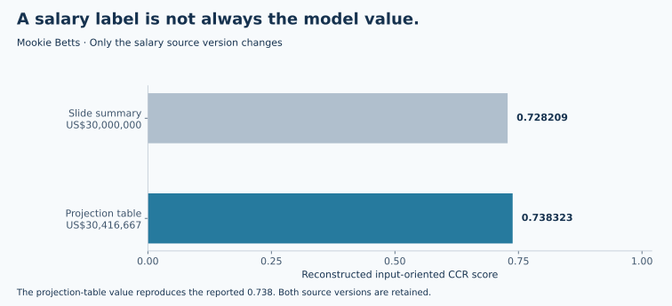

# MLB 球員績效與薪酬：從 DEA 分數到價值判斷

**資料包絡分析 · 線性規劃 · 個案分析 · 資料敘事**

[English](README.en.md) · [完整個案](docs/case-study.zh-TW.md) · [DEA 方法](docs/methodology.md) · [重現指南](docs/reproduce.md) · [成果歸屬](docs/contribution.md)

**打得更好，就一定領得更多嗎？效率分數又是在替誰回答問題？**

這個案例以六位 MLB 球員的 2023 年打擊表現與報告所列的 2024 年薪資為例，運用 DEA 比較多項指標，再把結果放回球員、球隊與運動商業生態系中解讀。原課程報告的問題是「球員績效是否等於球員價值」；本次整理新增可執行的模型重建、來源核對與視角比較，讓讀者能從數字一路檢查到結論。

> **核心發現：** 相同球員、相同資料，只要把「打擊表現 → 薪資」改成「薪資 → 打擊表現」，相對效率的故事就會改變。分數必須和投入產出定義一起閱讀，才能支援決策。


*圖中左側為原報告設定的 CCR 重建；右側為本次新增的球隊成本視角診斷。兩者都使用歷史投影片資料，不是當前球員排名或薪資估價。*

## 分析如何展開

1. **建立問題：** 從「明星球員為何有價值」切入，分開討論場上表現、票房與轉播、品牌商機及合約風險。
2. **整理證據：** 轉錄 6 位球員、12 項打擊指標、薪資、效率摘要、標竿權重與投影表，逐一記錄頁碼與欄位定義。
3. **重建模型：** 以 Python、SciPy 與 HiGHS 求解投入導向 CCR，核對原分數、權重及投影；比較薪資口徑與 BCC 假設。
4. **解釋結果：** 用 Stanton 與 Freeman 的反差說明模型視角，再連結事前預期、事後績效及未衡量的商業價值。
5. **提出決策框架：** 將球場績效、商業貢獻與合約風險分開衡量，提出下一步資料需求與驗證方式。

## 原結果與本次重建

| 球員 | 原報告分數 | CCR 重建 | BCC 延伸 | 球隊成本視角延伸 |
|---|---:|---:|---:|---:|
| Aaron Judge | 1.000 | 1.000000 | 1.000000 | 0.752840 |
| Giancarlo Stanton | 1.000 | 1.000000 | 1.000000 | 0.798989 |
| D.J. LeMahieu | 0.831 | 0.831409 | 1.000000 | 1.000000 |
| Shohei Ohtani | 1.000 | 1.000000 | 1.000000 | 0.735824 |
| Mookie Betts | 0.738 | 0.738323 | 0.787132 | 1.000000 |
| Freddie Freeman | 0.731 | 0.730530 | 0.816253 | 1.000000 |

原設定將 **12 項打擊表現作為投入，薪資作為產出**。因此 Stanton 的 1.000 並不代表他是球隊最划算的投資；Freeman 的 0.731 也不代表他的打擊表現較差。球隊成本視角則改以薪資為投入、打擊表現為產出，僅用來展示問題定義的影響。[完整解讀](docs/case-study.zh-TW.md)

效率值相同的球員不依分數強行排序。原簡報另列的名次保存在資料中，但未提供超效率或其他排序計算，不能視為已驗證的優劣排名。

## 一處資料口徑，如何改變結果



Betts 在簡報摘要的薪資標籤為 **US$30,000,000**，投影表原始值則為 **US$30,416,667**。使用投影表數值可重建 **0.738323**，與原報告 0.738 一致；若直接使用 30M，分數變成 **0.728209**。兩種數值皆保留，沒有覆寫原資料。[資料字典與品質說明](data/README.md)

## 可以檢查的能力與成果

| 能力 | 可檢查的內容 |
|---|---|
| 數據分析 | [逐筆球員資料](data/players.csv)、[39 列投影資料](data/projections.csv)、[薪資口徑核對](docs/evidence-review.md) |
| 效率建模 | [投入導向 CCR／BCC 求解](scripts/dea.py)、[模型公式與零值處理](docs/methodology.md) |
| 可重現研究 | [重建與誤差核對](scripts/reproduce.py)、[完整輸出](results/reconstruction.json)、[行為測試](tests/test_dea.py) |
| 個案分析 | [績效、商業價值與合約風險的決策框架](docs/case-study.zh-TW.md) |
| 敘事與溝通 | 從問題、反直覺結果、模型解釋到管理判斷的[個案故事](docs/case-study.zh-TW.md)與[敘事設計](docs/storytelling.md) |

## 重現分析

已驗證環境：Python 3.14、NumPy 2.5.4、SciPy 1.18.1、Matplotlib 3.11.2。

```bash
python3 -m venv .venv
source .venv/bin/activate
python -m pip install -r requirements.txt
python scripts/reproduce.py --check
python -m unittest discover -s tests -v
python scripts/build_figures.py --check
python scripts/verify_publication.py
```

核對範圍：**6 個原分數、6 筆標竿權重與 39 列投影資料**。程式為 2026 年新增的重建，並非找回原課程程式或原軟體執行紀錄。詳細步驟與容許誤差見[重現指南](docs/reproduce.md)。

## 結論的適用範圍

本案只有 6 個 DMU，卻有 12 項投入與 1 項產出，且含相關的比率指標；分數對樣本、變數與模型假設敏感。原始 MLB 統計及薪資定義未另行獨立查核，模型亦未衡量守備、投球、商業收入、傷病或合約現值。模型可重現，不等於球員估值已被驗證。[證據與限制](docs/evidence-review.md)

## 來源與成果歸屬

來源為國立成功大學「進階績效管理」第二組的 55 頁期中簡報，PDF 中繼資料日期為 2024-12-08。**整份原始報告由李奕成完成**，涵蓋資料整理、DEA 分析、結果解讀、個案研究與簡報敘事；此分工由本人確認。原簡報以第二組共同署名，公開版保留此背景。公開版重寫、Python 重建與延伸診斷為 2026 年 AI 協作整理。[貢獻說明](docs/contribution.md)

完整團隊 PDF、球員照片及第三方截圖保留於本機；公開儲存庫提供重寫內容、數值轉錄、重繪圖表與來源頁碼。[來源清單](docs/sources.md) · [使用與歸屬聲明](NOTICE.md)
